# systemd-unit-audit

systemd-unit-audit reads `.service` files (or a whole directory such as `/etc/systemd/system`) and reports what an attacker would gain from a compromised service: it runs as root, can gain privileges, shares `/tmp`, can write to the OS, holds `CAP_SYS_ADMIN`, starts a binary from a world-writable path or carries a password in `Environment=`. Each finding names the file and the line of the directive, or the file when a protection is missing.



**Live demo:** https://jvch0512.github.io/systemd-unit-audit/ (Synthetic unit files.)

Vala 0.56 (GLib only). The demo page is rendered from the tool's `--tsv` output by `scripts/site.py` (Python 3, only needed to regenerate the page).

## Use

```bash
make build
build/systemd-unit-audit examples
build/systemd-unit-audit /etc/systemd/system --tsv
build/systemd-unit-audit myapp.service --fail-on high   # exit 1 on any high finding
```

A directory is scanned recursively for `*.service` files. Comments (`#`, `;`), line continuations (`\`) and later assignments that override earlier ones are handled like systemd does.

| Rule | Severity | What it catches |
|---|---|---|
| SYD001 | high or medium | the service runs as root: no `User=` or `User=root` and no `DynamicUser=yes` (high when it also lacks `NoNewPrivileges`) |
| SYD002 | medium | `NoNewPrivileges` is not `yes` |
| SYD003 | low | `PrivateTmp` is not `yes` |
| SYD004 | medium | `ProtectSystem` is not `yes`, `full` or `strict` |
| SYD005 | high | `CAP_SYS_ADMIN`, `CAP_SYS_MODULE`, `CAP_SYS_PTRACE` or `CAP_DAC_OVERRIDE` granted through `AmbientCapabilities` or kept in `CapabilityBoundingSet` |
| SYD006 | high | `ExecStart` (or `ExecStartPre`) runs a binary from `/tmp`, `/var/tmp` or `/dev/shm` |
| SYD007 | high | `ExecStart` pipes a download into a shell (`curl ... | sh`) |
| SYD008 | medium | `Environment=` holds a value named like a password, secret, token or key |
| SYD009 | low | `ProtectHome` is not `yes`, `read-only` or `tmpfs` |
| SYD010 | medium | `User=` is set but `ExecStart` starts with `+`, which runs the command with full root privileges |
| SYD000 | info | the file has no `[Service]` section |

See [examples](examples) and [docs/sample-output.txt](docs/sample-output.txt).

## Limits

- It reads unit files as written. Drop-in directories (`foo.service.d/`) are scanned as separate files, not merged into their unit.
- Specifiers such as `%i` and `%h` are not expanded.
- `systemd-analyze security` scores a running unit using the real manager. This tool reviews text files, so it works in code review and CI where systemd is not available.
- A oneshot unit that must be root is still reported: use the report as a review list, not a verdict.

## Where it fits

Linux hardening reviews, CIS checks on servers, code review of unit files in an infra repo.

## Tests

```bash
make test    # A Vala test program: parsing, overrides, continuations, every rule on good and bad units, hostile input, 3000-case fuzzing and CLI exit codes
```

MIT.

## Code scanning (SARIF)

`scripts/tsv2sarif.py` converts the `--tsv` output into SARIF 2.1.0, so findings show up in GitHub code scanning:

```sh
build/systemd-unit-audit examples --tsv | python3 scripts/tsv2sarif.py --tool systemd-unit-audit --prefix examples > results.sarif
```

Upload `results.sarif` with `github/codeql-action/upload-sarif`. Severities map to SARIF levels (critical and high to error, medium to warning, low and info to note) and to a `security-severity` score.
